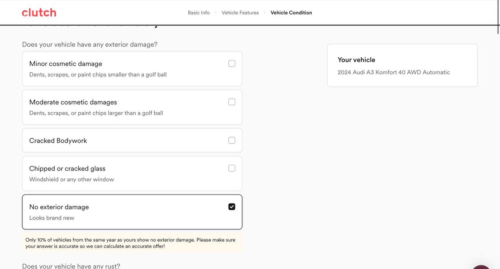
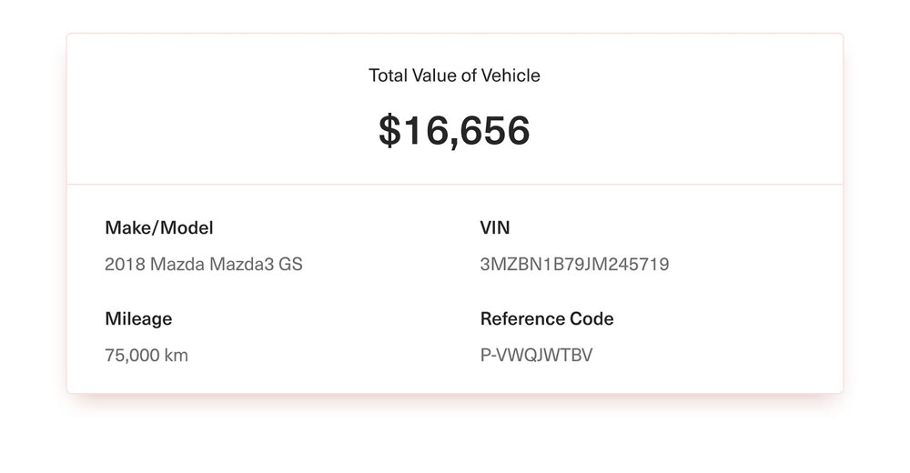
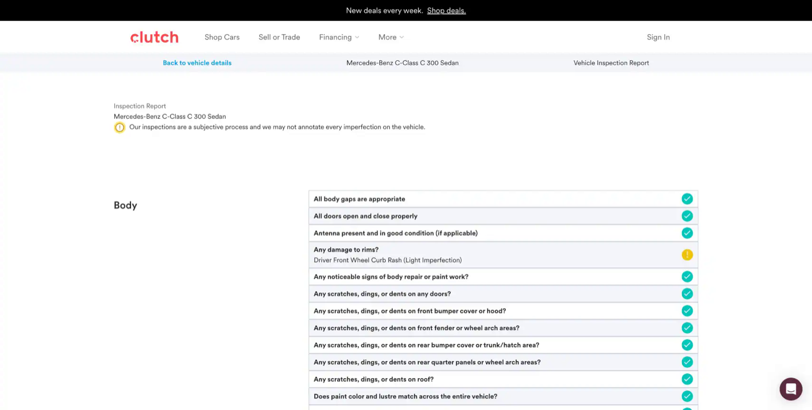

# Clutch's look

Redline should feel like a Clutch product, so a dealer who has seen clutch.ca recognises it and a Clutch team could ship it without a redesign. This page covers what was studied, what was adopted, and where it shows up.

## What was studied

- **The public site:** home, Sell or Trade, listings, a vehicle page, financing, FAQ and protection plans.
- **Clutch's sell flow, walked through on a tablet** from VIN to result, with a real car.
- **Press images** of the firm-offer card and the 210-point inspection report.

## Tokens adopted

- **Colour:** one hot red (#FF464C) on neutral greys. Ink #191919, body #272727, secondary #606060, borders #DDDDDD / #EEEEEE, page #FAFAFA. Red stays for brand and emphasis; green only on checkmarks.
- **Type:** Clutch uses Circular, which is licensed, so **Figtree** stands in. Bold display headings, 14–16px body, 32px bold prices.
- **Shape:** pill buttons and inputs (32px), 8px cards, 16px panels and sheets.
- **Depth:** borders over shadows. Most cards are a 1px border on a light grey page.
- **Tone:** short, plain, "you". Canadian spelling, km, CAD.

## Patterns reused

**The stepper.** Basic info › Features › Condition › Offer, with a sticky "Your vehicle" card beside the questions.

**Full-width option cards.** Each answer is a bordered card with an optional grey helper line. The selected one gets a **black** border and a black radio or checkbox. Not red.

**Buttons.** In-flow actions are **black pills** ("Continue") with a "← Back" link. The red gradient is for marketing CTAs only, so Redline uses it sparingly.

**Honesty nudges.** A pale-yellow note under an answer that looks too good: *"Only 10% of vehicles from the same year as yours show no exterior damage."* At a dealer desk this matters more: what Maria declares is what Sam checks on pickup day.

**The firm-offer card.** One big number, then the car's facts in a two-column grid. Redline keeps the card and adds the auction comparison beside it.

**The inspection report.** Clutch's 210-point report is a list of checks with a tick or a yellow "!" and a short note. Redline turns those rows into Sam's checklist, with the dealer's declared answer next to what he finds.

**The manual-review fallback.** When Clutch can't price a car instantly, the flow says *"We need a little bit more time"* and follows up within business days. Fine for an individual; it breaks a deal at a dealer desk. Redline keeps the honest message but tightens the promise: Maria gets a **firm offer by 3 p.m. the same day**, so the deal can still close today.

## Where it shows up in the app

- **Stepper, option cards, honesty nudges** → Trade-in (Maria)
- **Firm-offer card, same-day follow-up** → Trade-in result, and the re-price card in Back office (Dave)
- **Inspection report rows** → Inspector checklist (Sam, phone)
- **Black pills, borders over shadows, Figtree, red accents** → every screen, including the Ops board (Jordan)
- **Status colours** (green done, yellow needs attention) → Ops board exceptions and Back office notices
