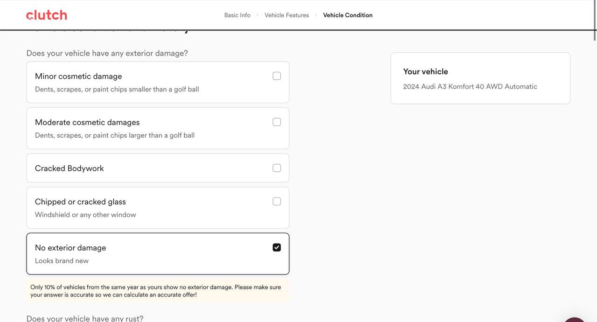
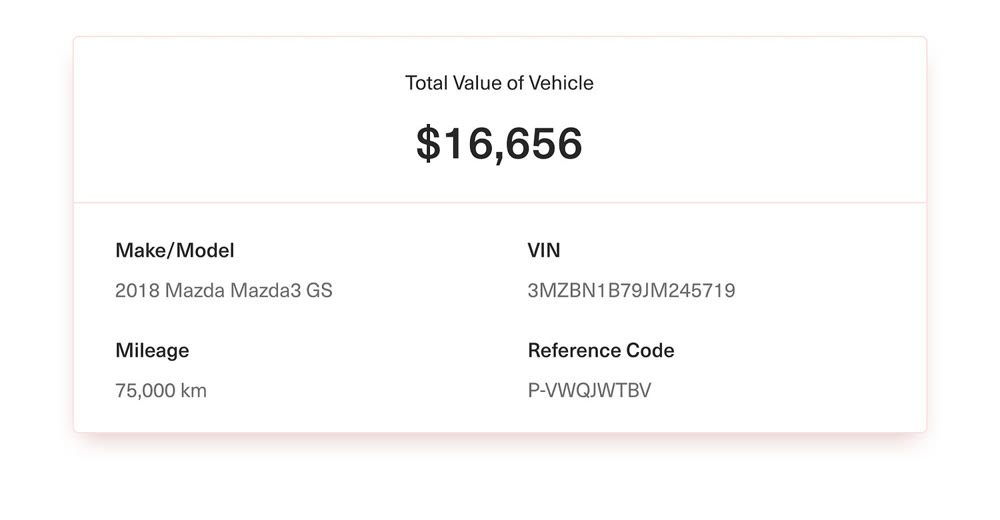
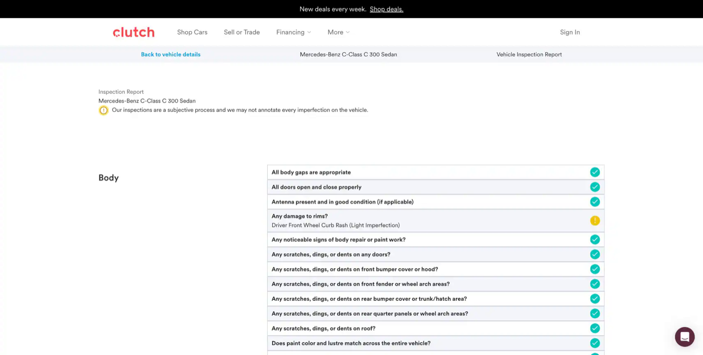

# Process

How the prototype was made, from the whiteboard to a live app. Every version mentioned here can be opened in Storybook (`npm run storybook`).

## 1. Start from the room

The whiteboard session became the Concept: the problem, what was learned in the room, and the idea in one line. One question that came up while building, whether the trade-in happens at the desk or online, got its own page instead of being settled quietly in a screen.

## 2. Study Clutch's product before designing

Clutch's public site, its sell flow walked through on a tablet with a real car, and press images of the firm-offer card and the inspection report. Colours, type, pill controls, black selected states and the pale-yellow honesty notes became the shared foundation every screen uses (Storybook → Foundations).

## 3. Three different versions of every module

Each module was first built as three deliberately different ideas, clickable on sample data and side by side in Storybook. Three versions force the trade-offs into view; one version only invites polish. Trade-in, for example:

::screens[trade-in]

## 4. Pick by person, then refine

Each pick came from who uses the screen and how, written up in The modules. Then each pick went through rounds of review: Trade-in took six. Clutch ops and Clutch inspector ended as a new version that combines the best parts of the first round.

## 5. Wire it to one live backend

The backend went in once the shell and the first picks were solid. Wiring changes the data, not the screens, so refining a screen later stayed a Storybook edit. One live query feeds every module, and every change is one transaction that also records who did what and why.

## 6. Click through it like a reviewer

A scripted browser click-through of the whole demo path, plus screen-fit checks at common laptop sizes and on a phone. Details are in Architecture.

## Tools

Built with Claude Code as a pair. The first versions of the four modules were built in parallel by four agents, each in its own git worktree and folder so they couldn't collide, in about ten minutes per module. The calls on each screen came from reviewing it as the person who'd use it; the agents did the building, the screenshots and the checks.
